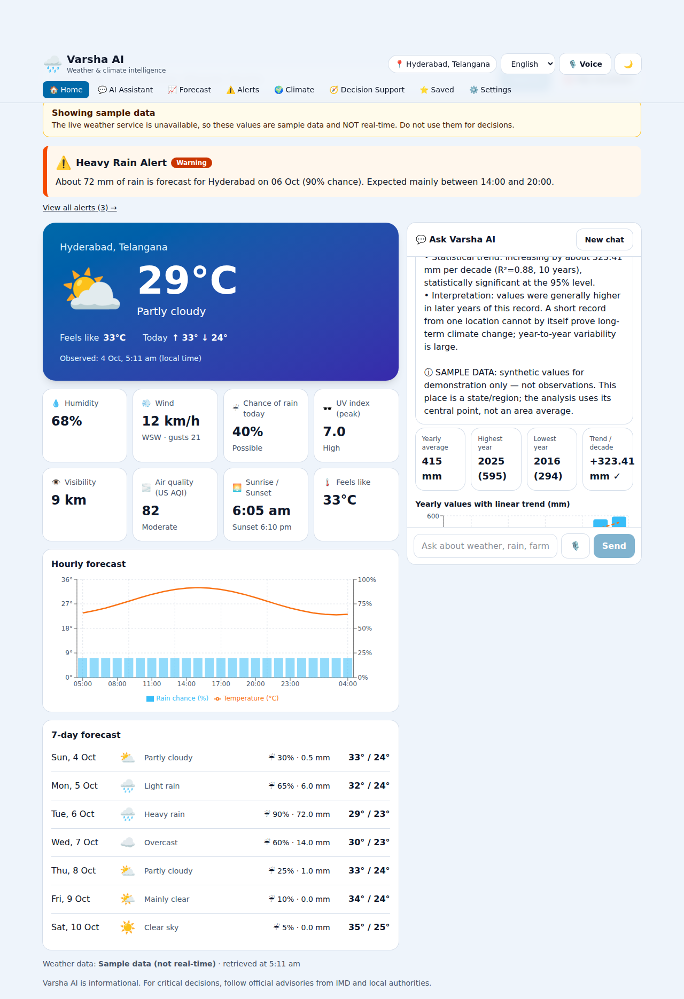
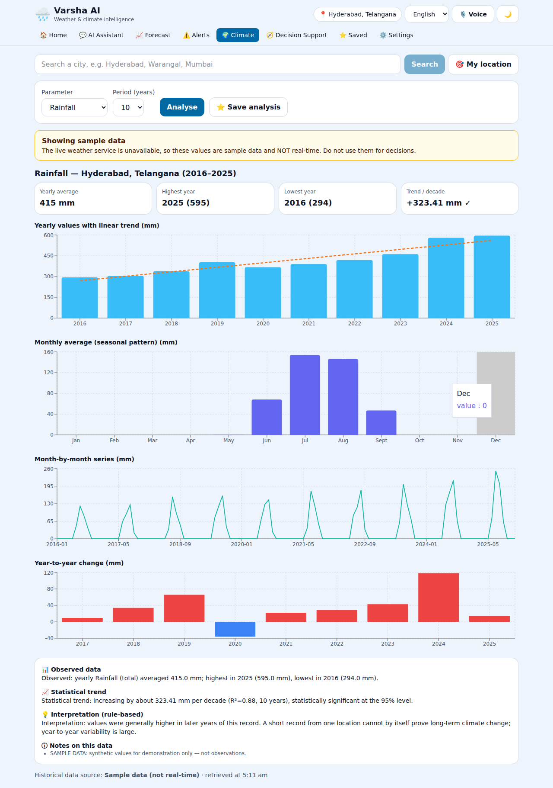
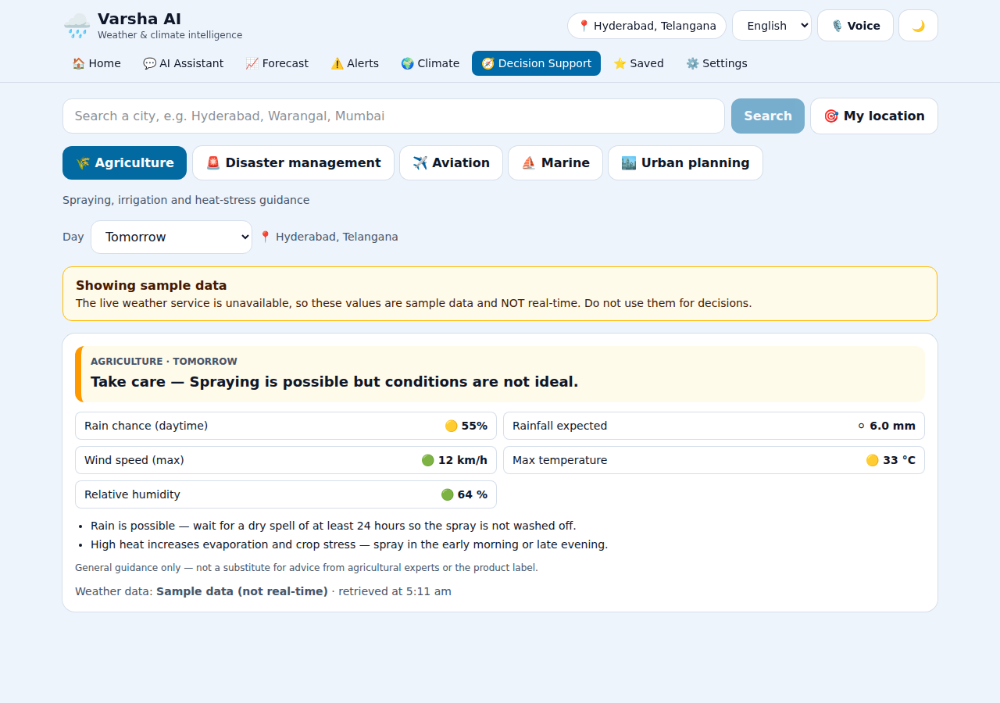
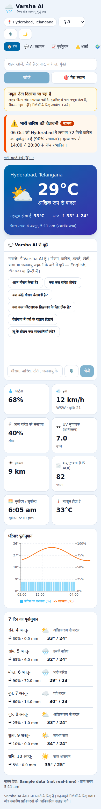

# Varsha AI — Conversational Weather & Climate Intelligence

> **Category:** Climate & Ocean Intelligence

Weather information is scattered across portals, bulletins and satellite products. **Varsha AI** is one conversational
platform that answers natural-language weather and climate questions — by text or voice, in **English, తెలుగు and हिन्दी** —
with forecasts, forecast-based alerts, climate trends and sector advisories (agriculture, disaster management,
aviation, marine, urban planning).

**Design rule:** weather numbers always come from the data provider. The LLM (optional) only interprets, summarises and
phrases — and every LLM reply is checked so it cannot introduce numbers that are not in the retrieved data.

## Screenshots
Captured in *mock-data mode* (the banner says so) because the build sandbox had no internet.

| Home + chat | Climate analysis |
|---|---|
|  |  |
| **Decision support** | **Mobile (Hindi)** |
|  |  |

## Features
- **Chat assistant** with intent / place / date understanding, short-term memory ("What about the day after?"), result cards and charts
- **Dashboard**: temperature, feels-like, humidity, wind, rain chance, UV, visibility, air quality; hourly (72 h) + 7-day forecast
- **Alert engine**: heavy rain, heat, thunderstorm, strong wind, flood risk, low visibility → *Information / Advisory / Warning / Severe Warning*; thresholds in `backend/app/alerts/thresholds.json`
- **Multilingual** (en / te / hi): chat, alerts, advisories, climate text, UI. Add a language by adding a column in `backend/app/i18n/messages.py` and `frontend/src/i18n.js`
- **Voice**: browser speech-to-text and text-to-speech (en-IN / te-IN / hi-IN where the device has voices); optional server endpoints for a dedicated speech API
- **Climate analysis**: ERA5 history (3–30 yrs) for rainfall / temperature / humidity; yearly, monthly, seasonal charts; linear trend with significance test; *observed data*, *statistical trend* and *interpretation* are shown separately
- **Decision support**: agriculture (spraying/irrigation), disaster management, aviation, marine, urban planning
- **Saved locations, saved analyses, conversation & alert history** (optional DB, no login), light/dark theme, accessible keyboard/screen-reader friendly UI
- **Resilience**: caching, per-IP rate limit, friendly errors, labelled mock fallback when the live provider is down

## Architecture
```
React/Vite/Tailwind ──/api──▶ FastAPI
                               ├─ chat/        NLU (rules, + LLM parser when needed) → sessions → orchestrator
                               ├─ ai/          LLMProvider interface (OpenAI-compatible, Anthropic) — optional
                               ├─ weather/     WeatherProvider interface (Open-Meteo, Mock)
                               ├─ services/    WeatherService: cache + mock fallback
                               ├─ alerts/      thresholds.json + rule engine
                               ├─ climate/     statistics & trend
                               ├─ decision/    sector advisors
                               ├─ i18n/        en/te/hi message catalogue
                               ├─ voice/       optional server STT/TTS
                               └─ database/    SQLAlchemy (SQLite default, PostgreSQL via DATABASE_URL) — optional
```
Simple lookups ("Temperature in Hyderabad?") never call the LLM. The LLM is used only for interpretive intents, and only if configured.

## Tech stack
React 18 · Vite · Tailwind CSS 4 · Recharts · FastAPI · httpx · SQLAlchemy · Open-Meteo (forecast, archive/ERA5, marine, air quality, geocoding).

## Install & run
```bash
# Backend  (Python 3.11+)
cd backend
python -m venv .venv && source .venv/bin/activate     # Windows: .venv\Scripts\activate
pip install -r requirements.txt
cp .env.example .env                                  # Windows: copy .env.example .env
uvicorn app.main:app --reload --port 8000             # docs: http://localhost:8000/docs

# Frontend  (Node 18+)
cd frontend
npm install
npm run dev                                           # http://localhost:5173
```
Tests: `cd backend && python -m pytest -q` (offline; uses the mock provider). No API key is needed to run the app.

### Enabling the AI layer (optional)
In `backend/.env`:
```
AI_PROVIDER=anthropic          # or openai (any OpenAI-compatible endpoint, e.g. Gemini via AI_BASE_URL)
AI_API_KEY=...                 # never commit this
AI_MODEL=claude-sonnet-5-5     # or e.g. gpt-4o-mini
```

### Deployment
`docker compose up --build` (backend + nginx-served frontend on :8080). *The Docker files were written but not built in the authoring sandbox — test before relying on them.*

## Environment variables
See `backend/.env.example` (all documented). Secrets live only in the backend environment; the frontend never sees API keys.

## API
Interactive docs at `/api` → `http://localhost:8000/docs`. Errors are always `{"error": {"code", "message"}}`.

| Method & path | Purpose |
|---|---|
| `GET /api/weather/current?city=` or `?lat=&lon=` | current conditions, AQI |
| `GET /api/weather/forecast` | 72 hourly + 7 daily points |
| `GET /api/weather/marine` | wave data (coastal points only) |
| `GET /api/alerts?...&lang=en\|te\|hi` | forecast-based alerts + disclaimer |
| `GET /api/alerts/thresholds`, `/api/alerts/history` | active thresholds; per-device alert history |
| `GET /api/climate/history?parameter=rainfall\|temperature\|humidity&years=10&ai=false` | history, stats, trend |
| `GET /api/decision/{agriculture\|disaster\|aviation\|marine\|urban}?day=0..6` | sector advisory |
| `POST /api/chat` | `{message, session_id?, language, location?}` → reply, cards, sources |
| `POST /api/voice/transcribe`, `POST /api/voice/speak` | optional server speech (501 unless `VOICE_PROVIDER=openai`) |
| `GET/POST/DELETE /api/locations`, `/api/analyses`, `GET /api/history/conversations` | saved data (header `X-Client-Id`) |

## Honest limitations
- **Not an official warning system.** Alerts are generated from model forecasts using configurable thresholds (rain levels follow IMD 24 h categories; others are general guidance). Cyclone tracks and IMD bulletins are not ingested — add an IMD/CAP provider for that.
- **Climate data is ERA5 reanalysis** (model-based, ~9–25 km), not rain-gauge data. State-level queries ("Telangana") use the region's centre point, not an area average. A 10-year, one-point record cannot by itself show long-term climate change.
- **Translations** (Telugu/Hindi templates) were written without native-speaker review — please have them reviewed before public use.
- **Voice** uses the browser's Web Speech API (best in Chrome/Edge; needs internet and an installed voice for TTS). The server speech endpoints are implemented but untested against a real provider.
- The LLM paths (Anthropic / OpenAI-compatible) were tested with a fake provider, not with live keys.
- The live Open-Meteo calls could not be exercised from the build sandbox (no internet); first run will confirm them. If they fail the UI shows labelled sample data.
- Open-Meteo's free tier is for non-commercial use; chat sessions are in-process memory (use Redis for multi-instance deployments).

## Future enhancements
IMD / CAP alert ingestion, cyclone tracking, district-level polygons, more Indian languages, server-side Indic STT/TTS, SMS/WhatsApp delivery, user accounts, Redis cache & sessions, push notifications, offline PWA.

## Team / contributors
_Add your team members here._
